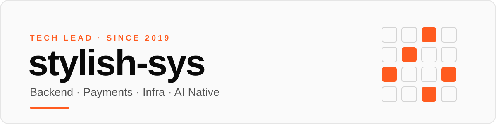

  <picture>
    <source media="(prefers-color-scheme: dark)" srcset="assets/header-dark.svg">
    
  </picture>

 

  
  
  

  결제, 커머스, SaaS 서비스를 만들고 운영합니다. 
  설계부터 구축, 운영, 자동화까지 혼자 끝까지 맡습니다.

## What I Build

| 분야 | 하는 일 |
| :-- | :-- |
| **Payments** <code>Backend · Infra</code> | 결제 시스템 설계·구축, WAS 이중화, 정산 파이프라인, 보안·감사 대응 |
| **SaaS** <code>Multi-tenant</code> | 결제 플랫폼 SaaS, 관리자 콘솔 개편, 멀티테넌트 아키텍처 |
| **Commerce** <code>Live Ops</code> | 커머스 서비스 운영 (Spring, MariaDB, Redis, Cloud) |

## Side Projects · OSS

| 분야 | 하는 일 |
| :-- | :-- |
| **Multi-site Ops** <code>Solo</code> | 수십 개 서비스를 단일 VPS에서 운영 (Cloudflare, Docker, Astro, Next.js, FastAPI) |
| **AI Agents** <code>OSS · Claude Code</code> | 멀티에이전트 오케스트레이션, sub-agent 워크플로. 1인 = 5인 팀 |
| **Automation** <code>Bots</code> | AI 자동 발행·수집 봇 (Python, Playwright, cron, Telegram) |

## Tech Stack

   
  

## Focus

| 항목 | 내용 |
| :-- | :-- |
| **Domains** | Payments, Commerce, SaaS, Public/Education Web |
| **Roles** | Backend, Infra, DevOps Automation, AI Integration |
| **Way of work** | Solo lead, end-to-end: 설계 → 구축 → 운영 → 자동화 |

Build Anything with AI

